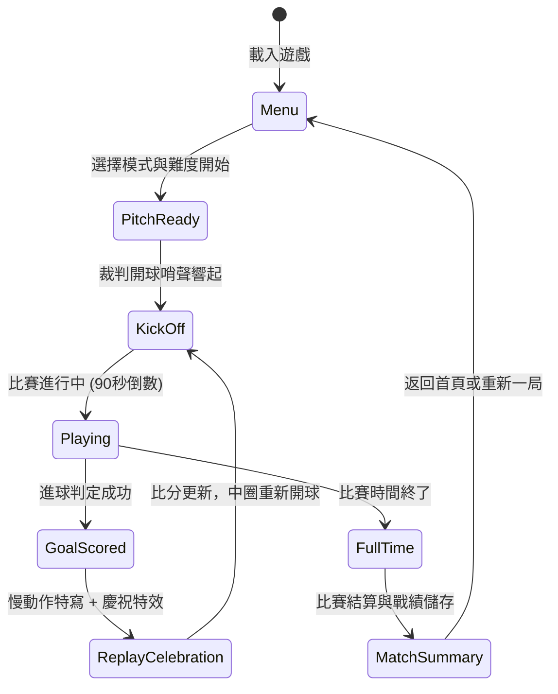

# 網頁版 2D 足球對戰遊戲系統規格書 (Soccer Game PRD)

## 1. 系統概述與願景 (System Overview)

本專案旨在為 `soccer_game` 打造一款**高流暢度、高回饋感、現代電競風格的網頁版 2D 足球遊戲**。
專案全方位參考 `stock_dash` 之成熟網站架構：
1. **後端架構**：採用 Python + Django 搭配輕量關聯資料庫（SQLite），負責提供遊戲主頁面、比賽記錄保存、排行榜、賽事數據統計與 AJAX API 端點。
2. **前端架構**：不依賴龐重外部框架，使用原生 HTML5 Canvas 2D + Vanilla CSS + 模組化 JavaScript (ES6 Modules)，達到 60 FPS 極致流暢體驗。
3. **沉浸式音效**：使用 Web Audio API 原生合成音效（踢球撞擊聲、哨聲、擊中球門柱、觀眾歡呼），零外部資源載入延遲。
4. **完整工程規範**：規格書導向（`specs/`）、獨立深色科技風 HTML 文件體系（`docs/`）、以及清晰的程式碼品質與單元測試規範。

---

## 2. 系統架構與技術棧 (Architecture & Tech Stack)

### 2.1 整體系統架構圖

```mermaid
graph TD
    subgraph Client [前端用戶端 (HTML5 / Canvas / Vanilla JS)]
        Canvas[Canvas 2D 遊戲視窗 (60 FPS)]
        Physics[物理引擎 Physics Engine]
        Controller[輸入控制器 Input Manager]
        AI[電腦 AI 決策系統 AI Engine]
        Audio[Web Audio 原生合成音訊]
        HUD[即時賽事 HUD / 計分板]
        AjaxClient[AJAX API 呼叫器]
    end

    subgraph Server [後端伺服器 (Django 核心)]
        Router[Django URL 路由器 (mysite/urls.py)]
        View[遊戲視圖與 API (game/views.py)]
        ORM[Django ORM 資料層]
    end

    subgraph Storage [資料儲存層]
        DB[(SQLite / 資料庫)]
    end

    Controller --> Physics
    Physics --> Canvas
    AI --> Physics
    Physics --> Audio
    Physics --> HUD
    HUD --> AjaxClient
    AjaxClient -->|POST /ajax/save_match/| Router
    Router --> View
    View --> ORM
    ORM --> DB
```

### 2.2 技術棧清單

| 分層 | 技術 / 工具 | 說明 |
| :--- | :--- | :--- |
| **後端核心** | Python 3 + Django | 參考 `stock_dash`，提供完整 Web 伺服器、路由與模板渲染 |
| **資料庫** | SQLite (內建零設定) | 儲存比賽歷史、玩家戰績、生涯統計與排行榜 |
| **前端遊戲核心** | HTML5 Canvas 2D + ES6 | 模組化設計：`engine/`、`entities/`、`ai/`、`audio/` |
| **前端樣式** | Vanilla CSS (Dark Modern Sports) | 電競深色主題、草皮質感、流暢微動畫，不依賴 Tailwind |
| **音訊系統** | Web Audio API (Synthesizer) | 原生振盪器與噪聲合成，無須額外下載大型音檔 |
| **開發與測試** | Django Test Runner + ESLint | 單元測試後端 API 與戰績計算，維持程式品質 |

---

## 3. 遊戲核心機制與物理規範 (Core Gameplay & Physics)

### 3.1 球場座標系與尺寸標準

- **畫布解析度**：標準 960 × 600 像素（支援高畫質螢幕 DPR 縮放與 CSS 自適應居中）。
- **球場邊界 (Pitch Boundary)**：
  - 左界 / 右界：`x: 60` ~ `x: 900`
  - 上界 / 下界：`y: 40` ~ `y: 560`
  - 中圈半徑：`75px`
  - 禁區深度：`110px`，高度：`240px`
  - 球門規格：
    - 左球門（主隊防守 / 客隊進攻）：`x: 30 ~ 60`，`y: 220 ~ 380`（高度 160px）
    - 右球門（客隊防守 / 主隊進攻）：`x: 900 ~ 930`，`y: 220 ~ 380`（高度 160px）
    - 門柱與球網：包含左右側立柱與橫樑的精準圓形/線段碰撞箱，球網具備阻尼係數。

### 3.2 足球物理引擎 (Ball Dynamics)

| 物理參數 | 數值 / 公式 | 說明 |
| :--- | :--- | :--- |
| **球體半徑** | `10 px` | 帶經典黑白五角球皮或科技螢光塗裝 |
| **滾動摩擦力** | `friction = 0.985` | 每幀速度衰減 `vx *= friction; vy *= friction` |
| **邊界彈性** | `restitution = 0.82` | 碰撞邊線時速度反彈並微幅能量耗損 |
| **門柱反彈** | `post_bounce = 0.90` | 擊中門柱頂端或底部圓角產生清脆角度彈射 |
| **旋轉/香蕉球** | `magnus_effect = 0.05` | 射門蓄力並帶切向旋轉時產生弧線軌跡 |
| **球網吸收阻尼** | `net_damping = 0.40` | 入網後迅速減速並自然下墜，避免球衝出網外 |

### 3.3 球員物理與操控 (Player Dynamics)

- **基本屬性**：
  - 碰撞半徑：`18 px`
  - 最高跑動速度：`3.8 px/frame`（衝刺狀態 `5.5 px/frame`）
  - 加速度與轉向慣性：響應靈敏但具有微小啟動慣性與急停摩擦。
  - 體力條機制 (Stamina)：衝刺時消耗，放開按鍵時自動緩慢回充。
- **操控對照表**：

| 行為 | 單人/P1 玩家控制 | 雙人/P2 玩家控制 | 行為描述 |
| :--- | :--- | :--- | :--- |
| **移動跑動** | `W, A, S, D` (1P 亦支援方向鍵) | `方向鍵` 或 `小鍵盤 8/4/5/6` | 8 方向平滑移動（P1/P2 完全隔離不衝突） |
| **衝刺跑** | `左 Shift` (1P 亦支援右 Shift) | `右 Shift` / `小鍵盤 0` / `/` | 消耗體力加速跑動 |
| **蓄力射門** | `Space` / `K` / `F` 鍵 (長按蓄力) | `Enter` / `.` / `小鍵盤 2` (長按) | 長按蓄力條增加射門球速，放開即射 |
| **短傳 / 搶斷** | `J` / `G` 鍵 | `,` / `小鍵盤 1` / `小鍵盤 3` | 無球時滑鏟搶斷，持球時快速短傳出腳 |
| **暫停** | `Escape` 或 `P` 鍵 | `Escape` 或 `P` 鍵 | 開啟暫停選單與設定 |

### 3.4 帶球、蓄力射門與搶斷機制

1. **吸附與帶球 (Dribbling)**：
   - 當球員與足球距離 `<= 26px` 時進入「控球範圍 (In Possession)」。
   - 帶球時，足球會被微弱彈性引力約束在球員運動方向前方 `18px` 處，隨球員轉向平滑切換。
2. **蓄力射門 (Power Shooting)**：
   - 蓄力計量條介於 `0% ~ 100%`（蓄力時間約 0.8 秒封頂）。
   - 射門方向由球員當前面朝方向與玩家瞄準向量共同加權決定。
   - 射門初速：`8.0 px/frame` ~ `18.0 px/frame`。
3. **滑鏟搶斷 (Tackle)**：
   - 觸發時球員朝當前方向瞬間滑行，若接觸到持球對手，則持球者短暫失去控球判定 `0.4` 秒，足球脫離並向切線飛出。

---

## 4. 電腦 AI 決策系統 (AI Engine)

電腦 AI 採用**階層式有限狀態機 (Hierarchical FSM)**，分為「前鋒/中場」與「專職守門員」兩種角色邏輯：

### 4.1 門將守備 AI (Goalkeeper FSM)
- **守備站位**：永遠保持在球門中線與足球連線的黃金夾角角平分線上，不輕易出擊，緊盯球門兩側死角。
- **撲救反應**：當檢測到高危險射門向量逼近球門時，觸發快速撲救橫移，並具備隨機撲救誤差（依難度調整）。
- **禁區解圍**：球進入禁區且無人接應時，門將出擊大腳踢離禁區。

### 4.2 對手球員 AI (Outfield AI FSM)
- **狀態 1 - 奪球/逼搶 (Chase & Tackle)**：對手持球或自由球時，計算攔截截擊點（Lead Interception Point），全力逼近。
- **狀態 2 - 進攻帶球 (Dribble Forward)**：取得球權後，向對方半場推進，並主動避開玩家防守路徑。
- **狀態 3 - 瞄準射門 (Shoot Decision)**：進入射程且與球門角度適宜時，瞄準球門無門將站位的一側蓄力射門。
- **難度梯度**：
  - **Easy (初學者)**：反應延遲 250ms，射門不蓄力，跑動速度較慢。
  - **Medium (業餘組)**：正常反應，懂得在禁區邊緣瞄準射門。
  - **Hard (職業組)**：預判球路截擊、主動衝刺、具備精準變向帶球與刁鑽死角射門。

---

## 5. 賽事規則與遊戲流程 (Game Flow & Rules)



1. **常規賽事時長**：一場標準比賽時長為 90 秒真實時間（等同模擬 90 分鐘賽事）。
2. **進球判定 (Goal Detection)**：足球完整穿過球門線（`ball.x < 55` 且在球門 y 軸範圍內，或 `ball.x > 905`）即判進球。
3. **進球獎勵與慢動作重播 (Slow-Mo Replay)**：
   - 觸發畫面震動（Screen Shake 15 幀）。
   - 進入 0.3 倍速慢動作定格 1.5 秒。
   - 螢幕中央跳出動態「GOAL!!」震撼橫幅與繽紛彩帶粒子。
   - 播放進球哨音與群眾歡呼。
4. **勝負判定**：時間倒數歸零時，分數高者勝出；若比分相同則為平局（或可選黃金進球延長賽）。

---

## 6. 網站架構與資料庫設計 (Web & Database Specs)

延續 `stock_dash` 之架構風格，專案採用 `soccer_game/mysite/` 組織目錄：

### 6.1 目錄規劃

```
soccer_game/
├── docs/                      # 系統開發邏輯文檔 (現代深色科技風 HTML)
│   ├── index.html             # 文檔中心首頁
│   └── soccer_gameplay/       # 足球遊戲核心規格說明
│       └── index.html
├── specs/                     # 需求規格書專區 (PRD)
│   ├── README.md
│   └── soccer_gameplay/
│       └── spec.md
├── GEMINI.md                  # 專案技術規範與工作流程準則
├── README.md                  # 專案概覽與快速啟動指南
├── requirements.txt           # Python 依賴清單
└── mysite/                    # Web 應用主目錄 (Django)
    ├── manage.py
    ├── mysite/                # Django 設定檔 (settings, urls)
    │   ├── __init__.py
    │   ├── settings.py
    │   ├── urls.py
    │   └── wsgi.py
    ├── game/                  # 遊戲 App
    │   ├── __init__.py
    │   ├── admin.py
    │   ├── apps.py
    │   ├── models.py          # 比賽紀錄與排行榜資料模型
    │   ├── views.py           # 頁面視圖與 AJAX API
    │   ├── urls.py
    │   └── tests.py           # 單元與整合測試
    ├── templates/             # 頁面模板
    │   ├── base.html          # 共用版型 (深色科技導覽與頁尾)
    │   ├── game.html          # 遊戲主戰場
    │   ├── leaderboard.html   # 排行榜與歷史賽事
    │   └── stats.html         # 生涯戰績統計
    └── static/                # 靜態資源
        ├── css/
        │   ├── main.css       # 系統深色風格樣式
        │   └── game.css       # 球場與 HUD 特效樣式
        └── js/
            ├── game_main.js   # 遊戲入口與迴圈
            ├── engine/
            │   ├── canvas.js  # 畫布渲染與草皮繪製
            │   ├── physics.js # 剛體、摩擦力與碰撞
            │   └── audio.js   # Web Audio 音效合成器
            ├── entities/
            │   ├── ball.js    # 足球實體與尾跡
            │   ├── player.js  # 球員實體與動作狀態
            │   └── goal.js    # 球門與球網
            └── ai/
                └── bot_ai.js  # 電腦對手與門將決策樹
```

### 6.2 資料庫模型設計 (`game/models.py`)

```python
class MatchRecord(models.Model):
    """單場比賽完整數據紀錄"""
    player_score = models.IntegerField(verbose_name="玩家進球數")
    opponent_score = models.IntegerField(verbose_name="對手進球數")
    result = models.CharField(max_length=10, choices=[('WIN', '獲勝'), ('LOSS', '落敗'), ('DRAW', '平局')])
    difficulty = models.CharField(max_length=10, default='MEDIUM')
    shots_taken = models.IntegerField(default=0, verbose_name="射門次數")
    shots_on_target = models.IntegerField(default=0, verbose_name="射正次數")
    possession_rate = models.FloatField(default=50.0, verbose_name="控球率(%)")
    duration_seconds = models.IntegerField(default=90, verbose_name="比賽秒數")
    created_at = models.DateTimeField(auto_now_add=True, verbose_name="對戰時間")

    class Meta:
        ordering = ['-created_at']

class LeaderboardEntry(models.Model):
    """生涯勝率與排行榜彙整"""
    player_name = models.CharField(max_length=50, default="Player 1")
    total_matches = models.IntegerField(default=0)
    wins = models.IntegerField(default=0)
    losses = models.IntegerField(default=0)
    draws = models.IntegerField(default=0)
    total_goals_scored = models.IntegerField(default=0)
    total_goals_conceded = models.IntegerField(default=0)
    highest_win_streak = models.IntegerField(default=0)
    current_win_streak = models.IntegerField(default=0)
    updated_at = models.DateTimeField(auto_now=True)
```

### 6.3 AJAX API 端點設計 (完全對齊 `stock_dash` 習慣)

| 路由路徑 | HTTP 方法 | 功能說明 | 請求參數 / 回應內容 |
| :--- | :--- | :--- | :--- |
| `ajax/save_match/` | `POST` | 比賽結束後回傳儲存戰績 | Body: JSON (比分、射門、控球率、難度) → 回傳: 成功狀態與更新後連勝數 |
| `ajax/leaderboard/` | `GET` | 取得即時排行榜排行與名次 | 回傳: TOP 10 名單、勝率、總進球 |
| `ajax/stats/` | `GET` | 取得當前玩家生涯統計資訊 | 回傳: 總場次、勝率圓餅圖數據、最近 5 場歷史趨勢 |

---

## 7. 視覺美學與 UI/UX 規範 (Design Aesthetics)

對齊頂級現代網頁視覺準則：
1. **配色計畫 (Palette)**：
   - 足球草皮：質感深墨綠與草綠相間條紋 `#1b4332` / `#2d6a4f`，微帶冷光白色標線 `#ffffffcc`。
   - 儀表板深色底：`#0b0f19` (Slate Dark) 與卡片背景 `#111827`。
   - 科技亮眼點綴色：Cyan `#38bdf8` (主隊/玩家)、Emerald `#10b981` (進球/勝利)、Amber `#f59e0b` (蓄力條)、Rose `#f43f5e` (客隊/警告)。
2. **遊戲 HUD (Head-Up Display)**：
   - 頂部懸浮式電競比分看板：含雙方隊徽、隊名、大字即時比分與動態計時條。
   - 腳下動態指示光環：持球時顯示半徑能量光圈，蓄力時展開漸層弧形力量條。
   - 操作教學面板：右上方半透明迷你快捷鍵提醒（可隨時收折）。
3. **動態打擊感 (Juice)**：
   - 足球擊中門柱的金屬顫動反饋。
   - 射門時粒子尾跡 (Speed Tail Particles)。
   - 勝利結算畫面的 Confetti 彩花盛宴與進球重播。

---

## 8. 分階段實作計畫 (Implementation Phases)

| 階段 | 核心任務 | 交付目標 |
| :--- | :--- | :--- |
| **Phase 1: 專案基底與後端架構** | 建立 `mysite/` Django 專案、SQLite 設定、靜態與模板目錄結構、`GEMINI.md`、`docs/` 文件 | 跑通 `python manage.py runserver`，首頁正常渲染 |
| **Phase 2: 球場畫布與物理引擎** | 實現 Canvas 2D 草皮渲染、足球滾動/摩擦/彈跳剛體物理、球門與邊界碰撞 | 畫面上能看到流暢彈跳與滾動的足球 |
| **Phase 3: 球員操控與 AI 對手** | 實作玩家輸入控制器 (WASD/射門/滑鏟)、帶球邏輯、電腦 AI 跑位與門將守門 | 實現玩家與電腦在場上搶球、帶球與射門 |
| **Phase 4: 賽事規則、HUD 與音效** | 90秒倒數計時、進球判定、開球重置、Web Audio API 合成音效、暫停介面 | 具備完整一場球賽的遊玩閉環與聽覺享受 |
| **Phase 5: 慢動作重播與進球打擊感** | 進球瞬間 0.3x 慢動作回放、螢幕震動、GOAL 橫幅動畫、彩帶粒子噴發 | 極致打擊感與沉浸體驗 |
| **Phase 6: 後端 API、戰績持久化與排行榜** | 實作 `ajax/save_match/`、數據模型儲存、戰績儀表板頁面、單元測試驗證 | 比賽結束後自動存檔，並可在儀表板查看歷史戰績 |

---

## 9. 驗收標準 (Acceptance Criteria)

- [ ] 遊戲能在現代瀏覽器中維持 60 FPS 穩定運行，無卡頓。
- [ ] 物理機制自然逼真：帶球平滑、蓄力射門速度感強烈、擊中門柱會產生彈射。
- [ ] 電腦 AI 與門將具備合理智商，不會呆站，具備追球防守與撲救能力。
- [ ] 具備 Web Audio 原生音效，射門、中柱、哨音、進球音效即時清晰。
- [ ] 比賽結束後，比分與數據可透過 AJAX 正確儲存至 Django SQLite 資料庫。
- [ ] 專案架構完全符合 `stock_dash` 規範（`specs/`、`docs/` Dark Mode HTML、`GEMINI.md`、`README.md`）。
